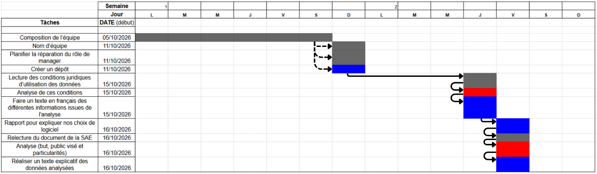

# Manager - 1 : Théo PALUGAN

Manager du 5/10/2026 au 18/10/2026.

## Objectifs :

### Livrable 1 : 

- Composition de l’équipe
- Nom d’équipe
- Planifier la répartition du rôle de manager
- Créer un dépôt :
  - Github
  - Google Drive
  - Discord

### Livrable 2 : 

- Lecture des conditions juridiques d’utilisation des données
- Analyse de ces conditions (droit et obligation)
- Rédiger un texte en français des différentes informations issues de l'analyse

### Livrable 3 : 

- Si possible installer une distribution Linux (Ubuntu)
- Installation : 
  - Visual Studio Code
  - PostgreSQL
  - Apache (apache2) 
  - Bootstrap et Bootstrap icons
  - JavaScript
  - Looping (AGL)
  - Grafana
  - PHP
- Faire un rapport pour expliquer nos choix et les spécificités  

### Livrable 4 : 

- Relecture du document de la SAE (“SAE 301 BUT2FA 2026-2027 Base de données de films ”) disponible sur le moodle.
- Analyse : 
  - But du projet
  - Public visé par le projet
  - Particularités du projet
  - Sécurité du projet
- Rédiger un texte explicatif des données analysées

## Diagramme de Gantt (5/10/2026 au 18/10/2026): 

Flèche complète = séquentielle  
Flèche en pointillés = parallèle  
Les jalons : (Bleu)  
Dépendances critiques : (Rouge)  

## Répartition du travail et avancement : 

| Tâches | Date début | Date Fin | Responsable | Avancement | Correspond aux attentes | Difficulté rencontrée |
| :---: | :---: | :---: | :---: | :---: | :---: | :---: |
| Composition de l’équipe | 05/10/2026 | 10/10/2026 | Toute l’équipe | Terminé | Oui | |
| Nom d’équipe | 11/10/2026 | 11/10/2026 | Toute l’équipe | Terminé | Oui | |
| Planifier la répartition du rôle de manager | 11/10/2026 | 11/10/2026 | Théo PALUGAN | Terminé | Oui | |
| Créer un dépôt | 11/10/2026 | 11/10/2026 | Karl DIRIL / Théo PALUGAN | Terminé | Oui | |
| Lecture des conditions juridiques d’utilisation des données | 15/10/2026 | 15/10/2026 | Manase SAMUEL DIAKOLO / Karl DIRIL | Terminé | Oui | L'anglais |
| Analyse de ces conditions | 15/10/2026 | 15/10/2026 | Manase SAMUEL DIAKOLO / Karl DIRIL | Terminé | Oui | Exception de règles |
| Rédiger un texte en français des différentes informations issues de l'analyse | 15/10/2026 | 15/10/2026 | Manase SAMUEL DIAKOLO / Karl DIRIL | Terminé | Oui | |
| Rapport pour expliquer nos choix de logiciel | 16/10/2026 | 16/10/2026 | Toute l’équipe | Terminé | Oui | |
| Relecture du document de la SAE | 16/10/2026 | 16/10/2026 | Théo PALUGAN / Lucas CHEN | Terminé | Oui | |
| Analyse (but, public visé et particularités) | 16/10/2026 | 16/10/2026 | Théo PALUGAN / Lucas CHEN | Terminé | Oui | |
| Réaliser un texte explicatif des données analysées | 16/10/2026 | 16/10/2026 |Théo PALUGAN / Lucas CHEN | Terminé | Oui | |

## Évaluation individuelle des livrables : 

###  <ins> Livrable 1 :</ins>

Pour ce premier livrable, nous avons respecté les objectifs attendus et demandés avec la création et la composition de notre équipe que nous avons nommé “404”, nous avons donc réalisé une liste contenant tous les noms et prénoms de notre équipe.

Nous avons également proposé une répartition du rôle de manager qui commence avec moi (Théo PALUGAN) et qui suivra avec Karl DIRIL, Manase SAMUEL DIAKOLO, Lucas CHEN et ainsi de suite. Le tout avec un changement toutes les 2 semaines suivi d’un rapport, comme demandé dans les consignes.

Et pour finir nous avons créé un dépôt de code accessible à tous sur Github et nous avons ajouté le lien dans le rapport, nous avons également créé un espace commun entre les membres du groupe pour la rédaction des rapports via Google Drive.

Les objectifs à atteindre pour le livrable 1 ont tous été atteint car nous avons correctement réalisé la composition de l’équipe, la planification du rôle de manager et la mise en place d’un dépôt de code accessible à tous.

###  <ins> Livrable 2 :</ins>

Ce livrable avait pour but d'analyser les conditions juridiques des données initiales d'"IMDb". Dans ce cadre, nous avons décidé de réaliser cinq parties distinctes.

- La première avait pour but de fixer le périmètre sur ce que nous avions le droit de faire et de ne pas faire. Il se trouve que dans notre cas nous pouvions utiliser cette base de données mais à condition de ne pas mettre en ligne le projet.  
- La seconde se concentre sur les contraintes techniques qui nous sont imposées par le fait d'utiliser cette base de données. Le dépôt ne doit contenir que le code source, les fichiers de récupération et le schéma relationnel. Pour la récupération des fichiers, nous n'avons pas le droit de les récupérer via d'autres techniques comme le data mining par exemple.
-  La troisième appuie sur le fait qu'IMDb prévient qu'il y aura moins de pertinence entre les données de la base de données et les données sur leur site, et qu'il se réserve le droit de nous retirer l'autorisation d'utiliser leur base de données.
- La quatrième concerne le fait que, dès lors que notre plateforme deviendrait un produit commercial ouvert et public et continuerait à utiliser leur jeu de données, il faudrait négocier un accord payant
- La cinquième se focalise sur la protection des données personnelles. Vu que les données de la base de données ne sont pas personnelles, il n'y aura donc normalement aucun problème avec le RGPD.

La difficulté principale lors de ce livrable a été l'anglais et le choix des bonnes règles et des exceptions pour chacune d'entre elles.

Nous avons donc atteint l'objectif de ce livrable, car toutes les tâches à réaliser ont été correctement réalisées et donc grâce à nos différentes analyses nous permettent d'établir le périmètre pour cette base de données et de savoir ce que nous pouvons en faire et ce de manière légale. Ce travail nous a donc permis de mieux définir le cadre d'utilisation des données pour notre projet.

###  <ins> Livrable 3 :</ins>

L'objectif du livrable 3 était de nous orienter sur les logiciels que nous allions devoir utiliser pour mener à bien le projet. Ce livrable a comme particularité de ne pas être figé, nous pouvons donc modifier nos choix en apportant des modifications ou des ajouts soit avec des logiciels, versions, modules, …   

Pour ce faire, nous avons donc fait une liste explicative de chaque logiciel que nous pensons utile au projet et à la réalisation des livrables. Nous avons donc justifié dans nos explications pourquoi ce logiciel et non un autre, avec par exemple Looping et MySQL Workbench, ou encore en quoi ce logiciel va nous servir.   

Dans un second temps, nous avons ajouté des précisions aux logiciels que nous avons sélectionnés, en mettant en évidence grâce aux informations que nous avons cherchées : la version que nous pensons utiliser, les extensions et les modules. Nous avons donc ensuite justifié nos choix des différentes spécificités que nous avons sélectionnées et qui pourraient correspondre aux attentes du projet.  

L’objectif à atteindre était la mise en place d’une plateforme de développement, et cet objectif a été atteint car nous avons expliqué les logiciels à utiliser et pourquoi eux ainsi que leur spécificité.  

###  <ins> Livrable 4 :</ins>

Le livrable 4 avait comme objectif de nous faire connaître les attendus de notre projet, le type de personnes visées par l'application, le but de l'application, les particularités que notre projet allait intégrer et la sécurité de l'application.

Nous avons donc commencé par une relecture complète du sujet de la SAE, puis nous sommes passés à son analyse, ce qui nous a permis de localiser le type de personnes visées par le projet et nous en avons déduit qu'il peut s'agir de n'importe qui, que ce soit une personne cherchant des informations sur un film, un passionné ou un professionnel. 

Le but est donc que n'importe qui puisse accéder à la fiche informative d'un film, acteur et réalisateur, et c'est à ce moment que les particularités font sens, notamment sur les différents types de recherche possible avec trois algorithmes différents qui permettent toutes des façons différentes de rechercher une information avec par exemple juste un nom, une temporalité avec des dates de naissance ou encore un lien entre des acteurs et des films.  

Nous avons également remarqué que la sécurité est une grosse partie du projet, spécifiquement sur l'aspect des injections SQL et des failles XSS, mais également sur les permissions de chaque rôle, c'est-à-dire faire en sorte qu'un rôle ne puisse faire uniquement ce qui lui a été autorisé et de correctement répartir ses responsabilités. 

Grâce à l'analyse du sujet de la SAE, nous avons pu réussir à réaliser ce livrable sans trop de difficultés. Nous avons donc réalisé un texte expliquant le but, le public visé, les particularités et la sécurité attendue, ce qui veut dire que tous les objectifs à atteindre ont été atteints. Ce livrable nous a permis de mieux comprendre les attendus de l'application et son utilité finale en plus du défi qui va nous être demandé pour être réalisé.

